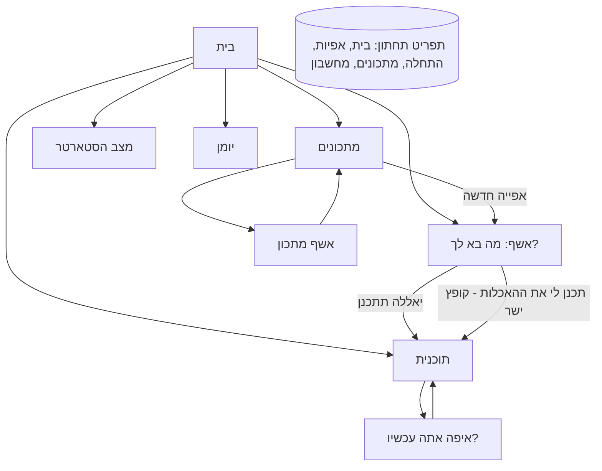
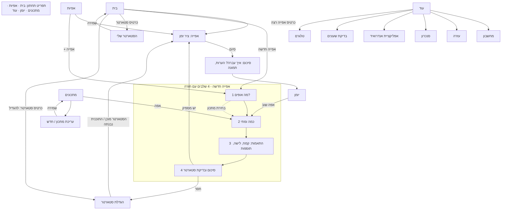

# מחמצת לעד: זרימות משתמש (User Flows)

גרסת מסמך 1, 2026-11-13. נכתב אחרי סקירה של האפליקציה v0.8.0 ברוחב טלפון (360px), של `docs/SPEC.md` ושל הקוד. המסמך הוא תכנון בלבד: שום דבר מהתיקונים עוד לא מומש.

## 0. עקרונות

1. **מתכון ≠ אפייה.** *מתכון* הוא תבנית שמורה (אצוות בסיס: פריטים, קמחים, הידרציה, ברירות מחדל). *אפייה* היא ריצה אחת בזמן אמיתי, עם שעות, שעונים, תמונות והערות. מתכון אחד מוליד הרבה אפיות. אפייה יכולה גם להתחיל בלי מתכון ("מאפס").
2. **הגדרות המתכון הן המלצה בלבד.** כל דבר ניתן לשינוי באפייה הזאת (כמות, מכפיל, לישה, אוטוליזה, לילה או אותו יום, תוספות, חלוקה), ובכל שלב בזמן הביצוע. שינוי באפייה לא משנה את המתכון. "שמור כמתכון חדש" היא פעולה יזומה ולא שאלה שקופצת בכל פעם.
3. **בדיקת סטארטר רק בשני מקומות:** (א) ברגע הפיכת התכנון לאפייה, ו־(ב) כרטיס הסטארטר בבית. מתכון, עריכת מתכון ועיון בתוכנית אף פעם לא בודקים כמה סטארטר יש.
4. **כל מסך עונה על שאלה אחת.** היום האשף החדש הוא מסך אחד ארוך עם יותר מ־12 כרטיסים. הכיוון: שלבים קצרים, כל אחד ברור, עם "הבא" ו"חזרה".
5. **כל כפתור מוביל למקום צפוי, וחזרה תמיד חוזרת למקום שממנו באת.** אין כפתור שקופץ שני מסכים קדימה.
6. **שעונים הם השימוש המרכזי.** כל שלב עם שעה הוא שעון אמיתי, והתראה תמיד מציעה: בוצע, נודניק, תוספת זמן.
7. **מהר ופשוט.** ברירות מחדל חכמות, שאלות רק כשהתשובה משנה את התוכנית.

## 1. מילון מונחים (נעול)

| מונח | משמעות | לא להשתמש ב |
|---|---|---|
| **מתכון** | תבנית שמורה | "תוכנית", "אפייה" |
| **אפייה** | ריצה אחת של מתכון (או מאפס) | "מתכון חדש" כשמתכוונים לאפייה |
| **אפיות רצות** | אפיות שהתחילו ולא נסגרו | "תוכנית" |
| **תוכנית** | רשימת השלבים של אפייה אחת (מסך) | |
| **הגדלת סטארטר** | סדרת האכלות לפני האפייה | "בנייה", "שרשרת" |
| **יומן אפיות** | אפיות שנסגרו | "היסטוריה" |
| **שלב** | שורה בתוכנית עם שעה ושעון | |

## 2. מפת מסכים וניווט

### 2.1 מצב נוכחי (v0.8.0)

בעיות במפה: "אפיות" ו"התחלה" בתפריט התחתון הן שני כניסות שנראות אותו דבר. מצב הסטארטר נשאל בארבעה מקומות. אין מסך גידול סטארטר, והתוכנית היא גם הכול.

### 2.2 מצב מכוון

### 2.3 כללי חזרה (Back)

- כל מסך שנפתח מתוך מסך אחר מציג חץ חזרה בראש המסך, והוא חוזר **למקום שממנו הגיעו**, לא תמיד לבית. כפתור "back" של אנדרואיד מתנהג אותו דבר.
- אשף אפייה חדשה: "חזרה" מחזירה לשלב הקודם ושומרת את מה שהוזן. יציאה מהאשף (X) שואלת רק אם הוזן משהו.
- עריכת מתכון: חזרה בלי שמירה שואלת "לבטל את השינויים?".
- תוכנית: אין "איבוד" אפייה בחזרה. אפייה רצה נשמרת תמיד.
- התפריט התחתון לעולם לא מאפס מצב אשף באמצע בלי לשאול.

## 3. תרחישים וזרימות

הפרסונה: **אילן**, אופה בית, מקליד בדיבור, סטארטר קשה, תנור ביתי, רוצה שהשעון יעיר אותו בדיוק ולא רוצה לחשב.

### 3.1 פתיחה ראשונה

1. בית. בראש: "אין אפייה רצה". אחריו **כרטיס יחיד** "יש לך סטארטר?" (שלוש תשובות: כן / כן אבל לא בטוח באיזה מצב / אין לי).
2. **כן:** שאלון סטארטר קצר (סוג, איפה, מתי הואכל, כמה). המסך מסתיים ב"שמור", חזרה לבית. הבית מציג כרטיס סטארטר עם מצב ("במקרר, הואכל לפני 9 ימים, צריך האכלת חיזוק").
3. **אין לי:** בית מציג "אין סטארטר" ושני כפתורים: "איך מכינים סטארטר" (מדריך קצר בן 7 ימים עם שעון יומי) ו"יש לי עכשיו". אסור שהכפתור "אפייה חדשה" יהיה חסום.
4. **דלג:** אפשר להתעלם. הכרטיס נשאר, והסטארטר נחשב "לא ידוע" עד שנשאל במסך הסיכום של אפייה חדשה.
- *מבוי סתום היום:* אין. הכרטיס "יש לך סטארטר" נשאר עד שעונים.
- *נקודת החלטה:* בלי סטארטר אפשר עדיין לתכנן אפייה, והסיכום יציע לתכנן הגדלה מ־10 גרם.

### 3.2 יש סטארטר: להתחיל אפייה ממתכון

1. בית או מתכונים: "אפה" ליד מתכון.
2. **שלב 1 מה אופים:** פריטים מהמתכון (לחם, לחמניות, פיצה...) עם כמות ומשקל, ומכפיל "כמה פעמים". אפשר להוסיף פריט, להסיר, ולצרף מתכון נוסף (בדיקת שילוב).
3. **שלב 2 כמה ומתי:** שעת יציאה מהתנור (ברירת מחדל מחר 09:45), "לילה במקרר" או "אותו יום".
4. **שלב 3 התאמות (מקופל כברירת מחדל, "הכול כפי שבמתכון"):** קמחים, הידרציה, לישה ידנית או מכונה, אוטוליזה, קיפולים, תוספות. הכול המלצה ואפשר לשנות.
5. **שלב 4 סיכום ובדיקת סטארטר:** כמה סטארטר נדרש, כמה יש ("יש לי: __ גרם", ברירת מחדל מהכרטיס בבית), והתוצאה:
   - **מספיק:** כפתור ראשי "התחל אפייה" ← מסך האפייה (3.5).
   - **חסר או מעט מדי מוכן:** המסך מסביר במילים פשוטות כמה חסר, ומציג שתי דרכים: "הגדל את הסטארטר" ← מסך הגדלת סטארטר (3.3), או "יש לי מספיק מוכן" (מקלידים כמה בפועל). אין כפתור התחלה פעיל עד שבוחרים.
   - **יותר מדי:** שואל "בטוח?" ומציע כמות מומלצת.
6. שינוי הגדרה ביחס למתכון: **לא קופץ שאלה**. בסיכום יש שורה קטנה "שונה מהמתכון: זיתים" ו"שמור כמתכון חדש" כאפשרות בסוף האפייה.

### 3.3 לא מספיק סטארטר: הגדלת סטארטר (מסך חדש)

הבעיה היום: "תכנן לי את ההאכלות" מקפיץ ישר לתוכנית האפייה. אין מסך שמסביר מה עושים עכשיו.

המסך המכוון, **הגדלת סטארטר** (נקרא גם דרך הכרטיס בבית):
1. כותרת: "צריך 120 ג' סטארטר, יש 30. מגדילים ב־2 האכלות."
2. ציר קצר: האכלה 1 (עכשיו, 30+30+... ), האכלה 2 (אחרי X שעות), "מוכן ב־שעה Y". כל האכלה עם כמויות וזמן והשעון שלה.
3. אפשרויות: "האכלה אחת ללילה" (1:6:3), "להאיץ" (יותר חם / יחס קטן), "לבחור פחות סטארטר באפייה".
4. כפתור ראשי: **"אשר והתחל"** ← יוצר את האפייה (השלבים הראשונים הם ההאכלות) ופותח את מסך האפייה בראש. "חזרה" ← סיכום האפייה, ללא שמירה.
5. בבית, כרטיס הסטארטר מציג את ההאכלה הבאה ומתי, כמו שלב.

### 3.4 המשך אפייה רצה

1. בית: כרטיס לכל אפייה רצה: שם, השלב הבא, ספירה לאחור. שלב עתידי רחוק מוצג בשעה ובתאריך ("מחר 06:32"). אפייה שהשלב הבא בה רחוק בימים מסומנת "ממתינה".
2. נגיעה פותחת את מסך האפייה כשהוא גולל לשלב הנוכחי.
3. נגיעה בשלב פותחת גיליון: בוצע, אני כאן עכשיו, הזז זמן (עם "גם את הבאים"), שעון כבוי או דלוק, לישה ידנית או מכונה (כשרלוונטי), הערה, מחק שלב (חופשי בלבד).
4. התחלה באמצע: "כבר התחלתי, אני כאן" ← בחירת השלב, כל מה שלפניו מסומן כבוצע.
5. חזרה ← מקום שממנו באת (בית או אפיות).

### 3.5 מסך אפייה (ציר הזמן)

מבנה מכוון, מלמעלה למטה: שם האפייה, מחליף אפיות (כשיש יותר מאחת), "מסיימים ב־", כפתורי פעולה קבועים (טמפרטורה, תמונה), **השלב הנוכחי** (גדול), הכמויות (מקופל), רשימת השלבים, "מתי אופים" (כפתור יחיד שנפתח לגיליון), ענפים לאחר חלוקה (כיכר, לחמניות), "+ שלב או הערה", סיום.

- **סיום:** כפתור "סיימתי" ← מסך סיכום קצר: איך עברה (הצליחה, לא הצליחה...), הערה, תמונה אחרונה, "שמור כמתכון חדש" אם שונה. שמירה ← יומן. ביטול אפייה הוא כפתור נפרד, אדום, עם אישור, ורושם ביומן "לא הושלמה" רק אם המשתמש בוחר.
- **אחרי חלוקה:** כל כיכר והלחמניות הן מסלולים עם שלבים ושעונים נפרדים.
- **טמפרטורה ותמונה:** גיליון תחתון, לא כרטיס פתוח באמצע המסך.

### 3.6 כמה אפיות במקביל

1. "אפייה חדשה" פועלת גם כשיש אפייה רצה, ולא סוגרת אותה.
2. **שמות ייחודיים:** כל אפייה מקבלת שם ברור כבר ביצירה ("לחם שבת, 16.11") ולא "1 לחמים". אפשר לשנות שם.
3. הבית מציג רשימה ממוינת לפי השלב הבא הקרוב. מסך האפיות מציג מחליף.
4. שעונים נושאים את שם האפייה בכותרת כשיש יותר מאחת. הודעת התראה מציעה "בוצע / נודניק" לאפייה הנכונה.
5. חיכוך: שתי אפיות שצריכות את אותו סטארטר. בסיכום של האפייה השנייה: "הסטארטר כבר משוריין ל'לחם שבת' (100 ג')". הכמות הזמינה מופחתת.
6. סיום אפייה אחת פותח את הבאה בתור, ולא משנה את האחרות.

### 3.7 מתכון: יצירה ועריכה

1. מתכונים ← "מתכון חדש" או "עריכה". מסך בעל 3 חלקים: מה (פריטים, אצוות בסיס), קמחים והידרציה, ברירות מחדל (לישה, אוטוליזה, קיפולים, תוספות מועדפות).
2. **אין כאן שום בדיקת סטארטר.** המסך מציג רק "ל־1000 ג' בצק מומלצים כ־100 ג' סטארטר".
3. שמירה ← מתכונים (חזרה). יש כפתור "שמור ואפה" ← שלב 2 באשף האפייה.
4. כרטיס מתכון: מועדף, "אפה", "X אפיות ביומן" (מסנן את היומן), עריכה, עוד (דף HTML לשיתוף, שכפל, מחק עם אישור). ייבוא וייצוא בתחתית.
5. **גרסאות:** "שמור כמתכון חדש" מאפייה שהשתנתה יוצר מתכון עם `derivedFrom`. מתכון שהוכפל או שולב לא נשמר אלא אם ביקשו.

### 3.8 יומן אפיות

1. כניסה מהתפריט ומהבית ("האחרונות" שלוש שורות).
2. רשימה לפי תאריך, סינון לפי סטטוס ולפי מתכון, חיפוש.
3. רשומה: שם, תאריך, איך עברה (ניתן לשינוי), הערות, תמונות, מדידות, תוספות. "אפה שוב" ← שלב 2 עם אותה בחירה. "שמור כמתכון".
4. סיפור האפייה (עתידי): בלוג תמונות ושיתוף HTML.

### 3.9 שעונים והתראות

1. הפעלה ראשונה באפליקציית אנדרואיד: בדיקת הרשאות (התראות, מסך מלא על המסך הנעול, סוללה) ו"צלצל לי בעוד 5 שניות". מוצג בעוד, וגם **פעם אחת** אחרי התקנה בבית.
2. כל שלב עם שעון הוא שעון אמיתי בשעון הטלפון עם כותרת: `<שם אפייה> · <שלב>`.
3. התראה: בוצע / נודניק 10 / +30 / פתח. בטלגרם (בעתיד) אותם כפתורים.
4. בדפדפן: התראה רק כשהאפליקציה פתוחה, והמסך מסביר זאת במילים פשוטות.
5. שינוי זמן של שלב מעדכן את השעון מיד.

## 4. פערים ובלגנים באפליקציה הנוכחית מול הזרימות

מדורגים לפי חומרה (1 הכי דחוף). כל סעיף מציין היכן זה בקוד.

| # | חומרה | הבעיה | מקור | הזרימה המכוונת |
|---|---|---|---|---|
| 1 | גבוהה | **"תכנן לי את ההאכלות" קופץ ישר לתוכנית האפייה.** אין מסך שמסביר מה עושים עכשיו, כמה האכלות, מתי מוכן. | `Wizard.tsx` (`go` ← `#/plan`) | 3.3 מסך הגדלת סטארטר |
| 2 | גבוהה | **אשף אפייה חדשה הוא מסך אחד עם 12+ כרטיסים.** הסטארטר ראשון, לפני שבחרת מה אופים, והכפתור החסום מופיע בתחתית רחוק מהסיבה. | `Wizard.tsx` | 3.2: ארבעה שלבים, סטארטר אחרון |
| 3 | גבוהה | **מצב הסטארטר נשאל ב־4 מקומות:** כרטיס בבית, שאלון הסטארטר, "יש לי עכשיו" באשף, ו"איפה אתה עכשיו?" בהתחלת ביצוע. תשובות סותרות אפשריות. | `Home`, `StarterStatus`, `Wizard`, `Start` | מקור אמת אחד: כרטיס הסטארטר. האשף קורא ממנו וכותב אליו |
| 4 | גבוהה | **"אפייה רצה" בבית מופיעה מרגע התכנון**, גם כשהשלב הראשון בעוד יום והיא רק תכנון. שתי אפיות נראות "רצות" יחד אף שאחת מהן מחר. | `Home.tsx` (`running`) | 3.4: מיון, "ממתינה", וזמן מלא |
| 5 | גבוהה | **שמות אפיות לא ייחודיים** ("1 לחמים" פעמיים), בבית, במחליף ובשעונים. | `Wizard.tsx` (`parts.join`) | 3.6 שמות ברורים |
| 6 | בינונית | **שאלת "שינית את המתכון, לשמור כחדש?" קופצת בכל אפייה**, בניגוד לעיקרון שהמתכון הוא המלצה. | `Wizard.tsx` (`askDerive`), `Plan.tsx` (`derive`) | 3.2 סעיף 6: שורה שקטה והצעה בסוף |
| 7 | בינונית | **"התחלת ביצוע: איפה אני?"** מופיע כמסך נפרד, שואל שוב על הסטארטר, ויוצר תוכנית חדשה שדורסת את הקיימת. שם לא ברור. | `Start.tsx`, `Plan.tsx` | 3.4 סעיף 4: "אני כאן" כגיליון בתוך האפייה, בלי שאלון סטארטר |
| 8 | בינונית | **שני כפתורי "סיום" באותו מקום:** "בטל אפייה" ו"סיימתי" באותו כפתור לפי מצב, בלי אישור, ובלי סיכום (איך עברה, הערה). | `Plan.tsx` (`finish`) | 3.5: סיכום וסטטוס, ביטול נפרד עם אישור |
| 9 | בינונית | **התפריט התחתון כפול ולא ברור:** "אפיות" ו"התחלה" מובילים למקומות דומים, ויש גם כפתור "להתחיל אפייה" בבית. אין יומן בתפריט. | `app.tsx` (`TABS`) | 2.2: בית · אפיות · מתכונים · יומן · עוד |
| 10 | בינונית | **אין כפתור חזרה ואין התנהגות back עקבית.** שמירת מתכון חוזרת למתכונים אבל "אפה" לא חוזר לשם. כניסה ל־`#/start` בלי אפייה נותנת "אין מתכון להתחיל" עם קישור שמטעה. | `app.tsx`, כל המסכים | 2.3 |
| 11 | בינונית | **כמות הסטארטר אחרי אפייה לא מתעדכנת**, ושתי אפיות מקבילות לא משריינות סטארטר. | `store.ts` | 3.6 סעיף 5 |
| 12 | בינונית | **כרטיס טמפרטורה פתוח באמצע התוכנית** ומרחיק את השלבים. | `Plan.tsx` | גיליון תחתון |
| 13 | נמוכה | **מבנה הבית:** כרטיס הסטארטר ארוך ואחרי כפתורי הכניסה. שורת הסבר אחרי הכפתורים כתובה כפסקה. "שלום!" וכותרת כפולה. | `Home.tsx` | בית קצר: אפיות רצות, "אפייה חדשה", סטארטר, יומן |
| 14 | נמוכה | **בדיקת שעונים בתחתית הבית** בלבד ולא אחרי התקנה. | `Alarms.tsx` | 3.9 סעיף 1 |
| 15 | נמוכה | **ניסוח:** "1 לחמים", "אפייה נוספת" כקישור בלי הקשר, "מתכון חדש" באפייה בלי מתכון. | כללי | פרק 1 |
| 16 | נמוכה | **טלגרם לא מחובר**, וסיפור האפייה (בלוג תמונות) עוד לא נבנה. | `bot/` | תחום נפרד |

### מה כן עובד טוב ושומרים

- מנוע החישובים, בדיקת שילוב מתכונים, יומן עם סינון ועריכה.
- הפרדה בין מתכון לבין בדיקת סטארטר (העיקרון קיים בקוד של מסך המתכון).
- חסימת כפתור ההתחלה כשהסטארטר לא מספיק, עם הסבר בעברית פשוטה.
- שעונים נפרדים לכל אפייה, מזהים ייחודיים.
- אין גלילה אופקית באף מסך בבדיקה ב־360px.

## 5. סדר מימוש מוצע

1. **מסך הגדלת סטארטר** והפסקת הקפיצה לתוכנית (פער 1) עם בדיקות e2e.
2. **אשף ב־4 שלבים** עם חזרה, סטארטר אחרון, בלי שאלת "שמור כחדש" (פערים 2, 6).
3. **מקור אמת לסטארטר** ושינוי "התחלת ביצוע" ל"אני כאן" בתוך האפייה (פערים 3, 7).
4. **בית ואפיות רצות:** מיון, "ממתינה", שמות ייחודיים (פערים 4, 5).
5. **סיום אפייה:** מסך סיכום וביטול נפרד (פער 8).
6. **תפריט וניווט:** חזרה עקבית, תפריט חדש (פערים 9, 10).
7. שאר הפערים הבינוניים והנמוכים.

## 6. החלטות ברירת מחדל שנקבעו כאן, ושאלות פתוחות

החלטות שנקבעו (אפשר לשנות בלי להתעכב):
- יומן אפיות נכנס לתפריט התחתון, והמחשבון עובר ל"עוד".
- ברירת המחדל לשם אפייה: `<שם המתכון>, <תאריך>` או `<פריטים>, <תאריך>`.
- שני כפתורי סיום נפרדים: "סיימתי" (סיכום) ו"בטל אפייה" (אישור).

שאלות פתוחות שבאמת משנות:
1. **שריון סטארטר בין אפיות מקבילות:** האם להפחית אוטומטית את הכמות הזמינה (מומלץ), או להשאיר בשליטת המשתמש?
2. **אפייה שנשארת "ממתינה" יותר משבוע:** לסגור אוטומטית כ"לא הושלמה", או רק להזכיר? (מומלץ: להזכיר).
